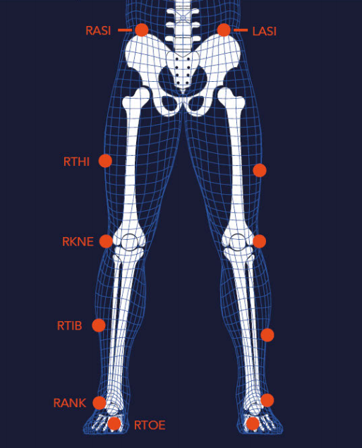
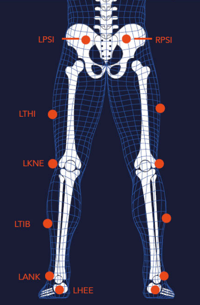
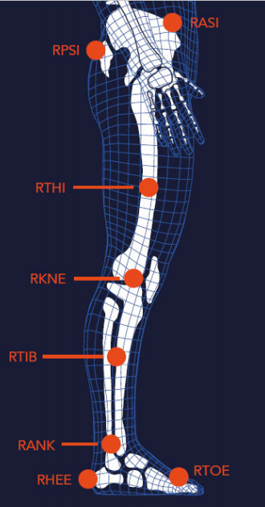
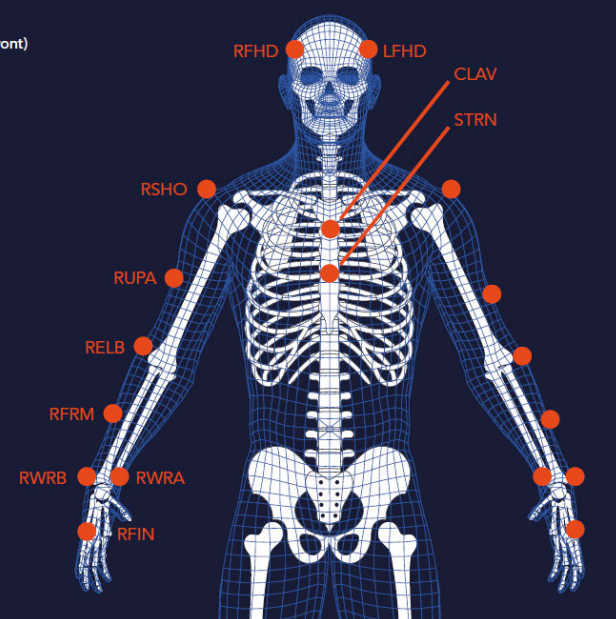
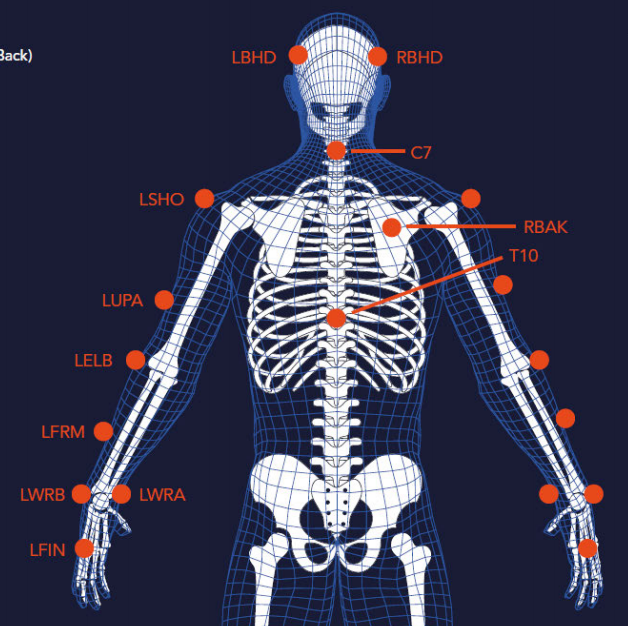
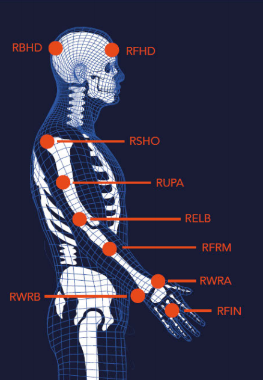

# Validation study

## general
- <mark>TODO:</mark> need iPad, test sync
- <mark>TODO:</mark> learn how to do Pull test
- <mark>TODO:</mark> uniform clothing? 
- preferred, tug, airing chair, balancing - 2X 
- beep, T, start position, beep

iPad sync
- start qtm
- settings, ble medscribe, connected when no lights are on
- start bridge script 

## marker positions

---

## Gait
- stand at far mark | walk | turn in place | walk back | turn in place
- contained in capture volume & walking outside for steady state

- slow, preferred, fast

## Pull test
- stand at close mark | pull | go back to mark |

## Timed-up-and-go
- (standing baseline (2s)) | sitting baseline (2s) | stand up | walk | turn  | walk | turn | sit down |

- no walking aid
- no armrests on chair
- in clinical setting they only look at the time currently
- 3m walkway

## Balancing
- normal floor eyes open baseline (2s) | foam eyes open baseline (2s) | foam eyes closed
- standing on foam
- parameters are not well established, mostly goes by eye
- baseline with eyes open, then eyes closed (?)

---
---

# Parameters

## Gait
1. stride time 
2. stride length
3. strdie width
4. stride velocity
5. swing time
6. double support time
7. knee ROM (?)
8. shoulder ROM (?)

## Pull test
1. pull magnitude (velocity)
2. number of corrective steps
3. first step latency
4. first step length
5. first step velocity (avg)
6. max retropulsion trunk angle
7. recovery time (trunk angle <75% of max angle)

## TUG
- walking phases (2x)  

    1. duration
    2. step count
    3. stride time
    4. stride length
    5. stride width
    6. stride velocity
    7. max trunk bending angle

- turning (2x)
    - turning phase cant start mid swing, the last step in the straight phase can be the first starting step in the tunr phase

    8. duration
    9. step count
    10. max angular velocity (wont work)

- standing up / sitting down

    11. duration (first movement -> standing up (hips & knees at x% of erect vertical height), standing -> sitting still)
    12. trunk bending max angle
    13. trunk bending max angular velocity
    14. max velocity (mid_shoulder)

15. performing 2 types of movement (turning and sitting down) at the same time? (overlapping segments, no threshold, make one up)

## Balancing

1. center of mass movement (statokinesigram, stabilogram)
2. total sway path (com movement in 2D)
3. center of mass frequency analysis (PSD, F50, F80, peak)
4. trunk bending (direction matters - affected side should be more common, bending compared to baseline, lower body or global vertical axis?<mark>TODO:</mark>)
5. arm ROM (compensation)
6. ankle joint movement (both?, mean? look it up in literature), range of motion in horizontal axes, spectral analysis maybe
7. knee joint movement
8. hip joint movement 
6. (?) number of steps taken
7. (?) step parameters (length, velocity, direction(?))
